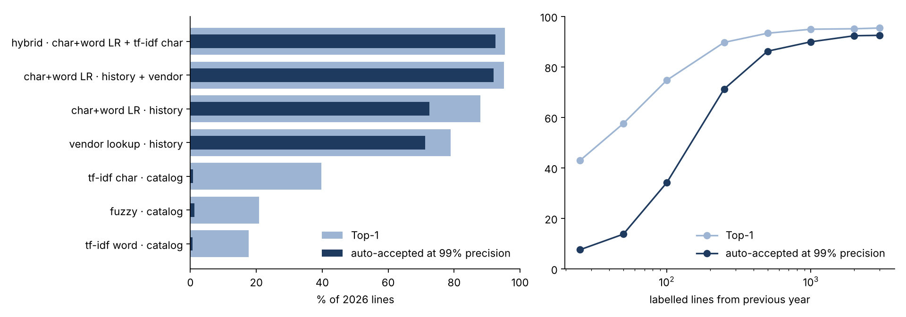

# ghgmatch

**Mapping messy procurement lines to spend-based emission factors: a reproducible benchmark of text-matching methods.**

Scope 3 accounting for a university starts with thousands of purchase lines like these:

```
DMEM Mediium 500ml                         Abcam          727.33 CHF
SPANNUNGSREGLER LDO GZ-895035 30 STK       Digi-Key       458.18 CHF
Airline Umbuchungsgeuehr                   BCD Travel     918.13 CHF
```

Each line has to be mapped to an emission-factor category before `spend × factor` gives tonnes of CO₂e. The text is short, mixes German and English, has typos, SKUs, abbreviations and vendors that sell everything. This repo compares the main ways of doing that mapping and packages the best one as a tool that can be rerun every year.



## Results

Trained on 3 000 labelled lines from "2025", tested on 2 000 lines from "2026". About 37 % of 2026 lines are products that never appear in 2025, and about 15 % of purchases go through generalist vendors (Galaxus, Amazon Business, …), so neither memorising products nor memorising vendors is enough.

| Method | Top-1 | Known items | New items | Top-3 | Total CO₂e error | Auto-accepted @ 99 % precision |
|:--|--:|--:|--:|--:|--:|--:|
| **Hybrid** (supervised LR + catalog TF-IDF) | **95.4 %** | 100.0 % | **87.6 %** | 98.2 % | **+1.3 %** | **92.5 %** |
| Supervised char+word LR + vendor | 95.0 % | 100.0 % | 86.6 % | 97.8 % | +1.6 % | 92.0 % |
| Supervised char+word LR | 87.9 % | 100.0 % | 67.4 % | 93.2 % | +1.1 % | 72.5 % |
| Vendor lookup | 79.0 % | 77.6 % | 81.4 % | 88.8 % | +6.4 % | 71.2 % |
| TF-IDF char n-grams vs. catalog (zero-shot) | 39.7 % | 43.5 % | 33.2 % | 58.1 % | +20.2 % | 0.8 % |
| Fuzzy matching vs. catalog (zero-shot) | 20.8 % | 21.3 % | 20.0 % | 33.7 % | +34.6 % | 1.2 % |
| TF-IDF words vs. catalog (zero-shot) | 17.6 % | 19.4 % | 14.6 % | 28.3 % | +21.4 % | 0.7 % |

Full table with MRR, macro-F1, spend-weighted accuracy and runtime: [`results/benchmark.md`](results/benchmark.md).

### What this shows

1. **String similarity against the catalog alone does not work.** Procurement text ("Pipettenspitzen 200ul") and factor-database text ("Disposable plastic labware") share almost no characters. Fuzzy matching gets about 1 line in 5 right and overstates total emissions by a third.
2. **Last year's manual mapping is the most valuable asset.** A plain character n-gram logistic regression trained on it is perfect on known products. Character n-grams are what make it robust to typos, German compounds and abbreviations.
3. **New products are the real problem.** That is where adding the vendor and the catalog prior helps most (67 % → 88 %), and where multilingual embeddings should help further (see below).
4. **Accuracy is not the metric that matters operationally.** The useful question is *how many lines can be accepted automatically while keeping 99 % precision*, so that only the rest goes to manual review. The hybrid auto-accepts 92.5 % of lines; the remaining 7.5 % are flagged with a second-best suggestion.
5. **About 250 labelled lines get most of the way there** (learning curve, right panel). Labelling effort can be planned.

## Methods

| Matcher | Needs labels | Idea |
|:--|:--:|:--|
| `FuzzyCatalogMatcher` | no | RapidFuzz `token_set_ratio` against category names and descriptions |
| `TfidfCatalogMatcher` | no | Cosine similarity of word or character n-gram TF-IDF vectors |
| `EmbeddingCatalogMatcher` | no | Multilingual sentence embeddings (`paraphrase-multilingual-MiniLM-L12-v2`) |
| `VendorPriorMatcher` | yes | Category distribution per vendor from previous years |
| `SupervisedTextMatcher` | yes | Character (2–5) + word (1–2) TF-IDF → logistic regression, optional vendor token |
| `HybridMatcher` | yes | Weighted product of experts over any matchers' probabilities |

All matchers return a probability over categories, so every one of them can be ranked, thresholded and combined the same way.

Metrics: top-1 / top-3 accuracy, MRR, macro-F1, **spend-weighted accuracy** (a wrong laptop matters more than a wrong pen), **total CO₂e error** (what the final inventory gets wrong) and **auto-accept coverage at 99 % precision**.

## Run it

```bash
pip install -e ".[dev]"
make all
```

or step by step:

```bash
ghgmatch generate
ghgmatch benchmark
ghgmatch predict data/procurement_2026.csv --threshold 0.8
pytest
```

`predict` writes the predicted category, confidence, an alternative category, a `needs_review` flag and the resulting t CO₂e per line.

To include the embedding matcher (downloads a ~120 MB model from Hugging Face):

```bash
pip install -e ".[embeddings]"
ghgmatch benchmark --embeddings
```

The embedding results are not in the table above yet because the model was not available in the environment where the benchmark was run.
